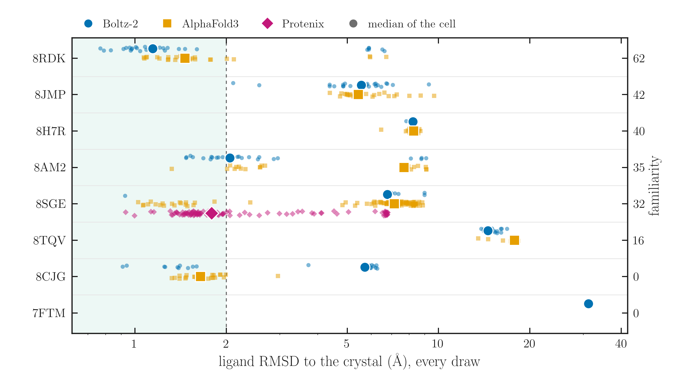
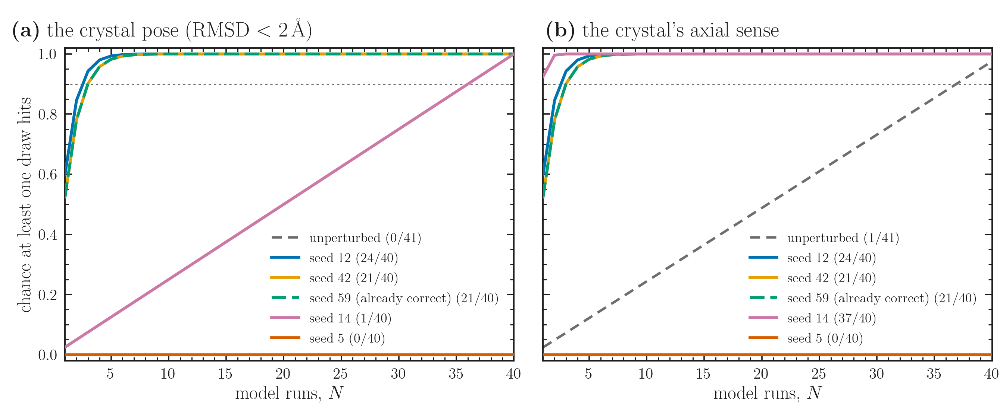

# Cofolding_TestTimeScaling

[Runs N' Poses](https://doi.org/10.1038/s41594-026-01797-5) showed that co-folding
accuracy scales with **familiarity** — how close a complex sits to something the
model was trained on. Read as a coverage problem, that points at more data and more
post-training.


Figure 1 of [Škrinjar, Eberhardt, Durairaj and
Schwede](https://doi.org/10.1101/2025.02.03.636309), reproduced unmodified under
[CC BY 4.0](https://creativecommons.org/licenses/by/4.0/) — the one figure here that
is not ours; see `results/figures/PROVENANCE.md`. Success is RMSD < 2 Å **and**
lDDT-PLI > 0.8, and the four methods are AlphaFold3, Protenix, Chai-1 and Boltz-1.

The grey line is the one to look at. It is the best of the four methods' top-ranked
models, picked with the answer in hand, and it runs above every individual method in
every bin: the models fail on different systems, so a good fraction of the misses are
already being produced by *somebody*. That is a selection and sampling statement, not
a coverage one, and it is the opening this repository works in.

This repository tests the other reading: that for at least some of these misses the
right pose is already inside the model's reach and the sampler never visits it. If
that holds, the miss is a **search** failure at inference, and the lever is
test-time compute rather than another training run.

It is a falsifiable claim, not a hopeful one, and what follows is the attempt to
break it — the shape of the failure, the fact that the obvious form of test-time
scaling does not work, and the one change that does make the right answer reachable.

## The failure is not one structure, and not one model



Every unperturbed draw this project has scored: 645 poses, 8 deposited complexes, 3
models, no oracle. A hit rate would hide the thing worth seeing, which is the shape
of each strip.

- **A tight clump far from the crystal is not uncertainty.** 7FTM's 25 Boltz-2 draws
  span 0.99 Å about a median of 31 Å; 8H7R's 30 span 0.56 Å about 8.2 Å. Drawing
  again returns the same wrong answer, which is why more samples do not help.
- **Two clumps with a gap is a choice between two answers** — 8CJG and 8AM2 under
  Boltz-2, 8SGE under AlphaFold3, 8RDK under both. What a hit rate reports is just
  the fraction that landed in the near clump.
- Four of the eight are missed by every model run on them, and where models disagree
  they disagree sharply and not in anyone's consistent favour. An empty slot is a
  model that was never run on that system, not one that scored badly.

Familiarity is on the right axis, and inside this set it does not order the outcome.
That is not a count against the Runs N' Poses trend: these eight were selected for
being hard, so the honest reading is that a population-level trend gives you no grip
on an individual complex — which is the case in which you would want to spend
inference compute.

Cells are not uniformly sampled, a hit here is RMSD < 2 Å alone rather than the
benchmark's stricter combined criterion, and Protenix has only been run on 8SGE —
read `data/cross_model/PROVENANCE.md` before quoting a rate.

## There are two answers, not a spread


Co-folding models do not place a ligand imprecisely. They choose between a small
number of placements, commit early, and are often confident and wrong.

300 poses on 8SGE, same molecule, same pocket and same MSA for all three models
(each at its own default recycling, so this is three published models, not a
controlled compute comparison). The RMSD marginal has two lobes with almost nothing between them: 0, 2 and 13 of 100 draws
land in the 2.5–5 Å gap. **Colour is the axial torsion** C12–C11–N1–C3 — the two
lobes are the two rotamers of one hindered bond, and the model picks one.

Two things fall out of that panel and set up everything else here:

- **The dashed lines are Runs N' Poses' own success criterion**, RMSD < 2 Å *and*
  lDDT-PLI > 0.8, so the top-left box of each panel is what that benchmark would
  score. It is stricter than RMSD alone and the gap is not small: Protenix's 64
  sub-2 Å poses are 25 successes, because a pose can be close and still have given up
  contacts. The best cut these 300 poses can support is 0.76, near the published 0.8
  — but no cut on lDDT-PLI selects anything in practice, since it draws its contact
  pairs from the deposited complex and so needs the answer it would stand in for.
- **The right axis is necessary, not sufficient.** AlphaFold3's green points at
  6–9 Å are the crystal's rotamer in the wrong place.


## Sampling harder does not help; changing the conditioning does

This is where the test-time scaling question gets answered, and the first answer is
no. Under a fixed conditioning the diffusion is near-deterministic — a given Boltz-2
seed returns the same pose every time, and the unperturbed draws on 8SGE agree with
each other to 0.11 Å while disagreeing with the crystal by 6.8 Å. Drawing more
samples buys almost no coverage; best-of-N over seeds re-rolls the conditioning, not
the pose.

Replacing the ligand's rows of the trunk single representation with matched Gaussian
noise, once, at the trunk-to-diffusion boundary, manufactures a distribution where
there was none.



| 8SGE, 20 draws an arm | in the crystal's basin |
| --- | --- |
| unperturbed control | 1 / 20 |
| `s_lig` destroyed (ours) | 9 / 20 |
| Boltz-Perturb TCP, C11 | **11 / 20** |
| TCP with the direction frozen for the run | 7 / 20 |
| TCP over the whole trajectory (C10) | 5 / 20 |

Same magnitude and schedule in the two C11 arms, so the **per-step redraw** is the
whole of that difference.

This is *oracle* best-of-N. It says the right answer becomes reachable, not that it
can be picked out — and on 8JJQ, where Boltz-2 is already right 18 times in 20, the
same intervention leaves 27 of 40. It adds variance, not knowledge.

Read back against the opening: on 8SGE the right pose was in reach the whole time,
so that miss was a sampling failure rather than a coverage one. Whether the same is
true of the other seven is open, and this repository does not settle it.

## Running it

**Inspect** — no GPU, no model, no checkpoint; committed data only.

```bash
pip install -e .
python scripts/figure_cross_model.py   # -> results/figures/cross_model.png
python scripts/figure_landscape.py     # -> results/figures/landscape.png
python scripts/figure_compound.py
python scripts/figure_bestofn.py
python scripts/figure_8sge.py
python scripts/viewer_8sge.py          # standalone 3D HTML, both basins
python -m pytest -q
```

Figures are drawn through `cofolding_tts.figstyle`: Computer Modern, boxed axes,
inward ticks. It renders text with LaTeX when a `latex` binary is on PATH and falls
back to matplotlib's own fonts when it is not, so a bare clone still produces every
figure.

**Reproduce** — needs a GPU. Boltz-2 is not vendored; one script installs it.

```bash
bash scripts/setup_boltz.sh            # a separate venv with boltz==2.2.1
export BOLTZ_CHECKPOINT=/path/to/boltz2_conf.ckpt
export BOLTZ_CACHE=/path/to/boltz/cache

python scripts/run_8sge.py --arm control --draws 30 --python .venv-boltz/bin/python
python scripts/run_8sge.py --arm gauss   --draws 40
python scripts/run_8sge.py --arm tcp     --draws 20     # also tcp-frozen, tcp-c10
python scripts/score_8sge.py --runs runs
```

Every number here was produced with **boltz 2.2.1**. The intervention patches named
attributes of named Boltz classes, so a release that moved one would install cleanly
and silently do nothing; the runner refuses any other version unless you pass
`--allow-any-boltz`. Runs land under `runs/`, which is not tracked.

## Notebooks

Four, self-contained, no GPU — `numpy`, `matplotlib` and this package over committed
data.

| notebook | what it shows |
| --- | --- |
| `01_baseline.ipynb` | the failure on 8SGE, recomputed from coordinates |
| `02_baselines.ipynb` | the unperturbed rate on four systems, with familiarity beside it |
| `03_tcp_arms.ipynb` | Boltz-Perturb's TCP against ours, and the frozen control |
| `04_committor.ipynb` | the committor along the hindered axis, and the tilt of the landscape |

## What is in here

```
src/cofolding_tts/   intervene.py (the hook + CLI), tcp.py, score.py, axis.py,
                     lddt.py, pose.py, pdbio.py, basin.py, figstyle.py
data/cross_model/    645 draws over 8 systems; 600 scored poses on 8SGE
data/baselines/      unperturbed draws and familiarity, four systems
data/tcp/            the five 8SGE arms, one row per pose
data/injection/      the step-140 coordinate-injection ladder
data/reference/      the 8SGE inputs a run needs
pdb/                 deposited structures for eight systems, with checksums
docs/method.md       what the intervention is and why it is where it is
```

## Limits

- **The failure is shown across systems and models; the rescue is characterised on
  one system with one model.** Every per-pose arm table committed here is Boltz-2 on
  8SGE.
- **Nothing ranks the draws.** Turning 11 of 20 into a prediction needs a
  reference-free selection signal, which is separate and unsolved.
- **The intervention has a cost.** 8JJQ goes 18/20 → 27/40; on 8CJG it goes the
  other way (7/20 → 40/40 and 39/40 under two conditionings); on 8AM2 it moves ~20%
  of draws in *both* directions. Those draws are not vendored here — pointers, not
  results you can check from this clone.
- **Ligand RMSD is always measured against the deposited ligand** after superposing
  the protein, never by fitting the ligand to itself.

## License

MIT, except `results/figures/rnp_familiarity.jpg`, which is someone else's figure
reproduced under CC BY 4.0 and attributed in `results/figures/PROVENANCE.md`. See
`LICENSE`.
