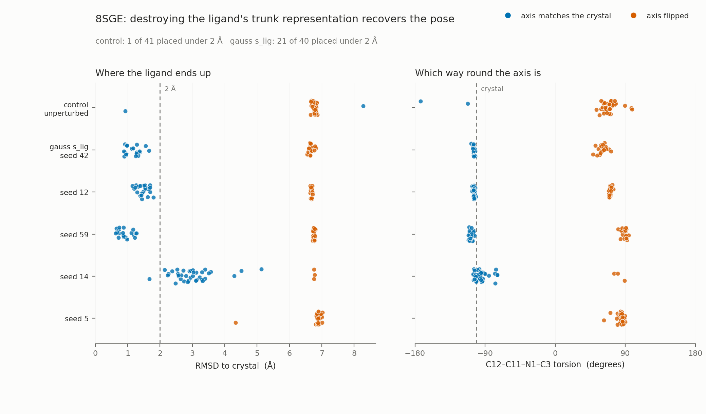

# Cofolding_TestTimeScaling

What co-folding models do at inference time, and what it takes to change their
minds.

This first cut contains one result, end to end. On PDB **8SGE**, Boltz-2 places the
ligand in the wrong rotamer of a hindered bond essentially every time. Replacing
the ligand's rows of the trunk single representation with matched Gaussian noise,
once, at the trunk-to-diffusion boundary, recovers the crystal placement about half
the time.

| arm | draws | axis matches crystal | placed under 2 Å | median RMSD |
|---|---|---|---|---|
| control, unperturbed | 41 | 2 | 1 | 6.77 Å |
| `gauss s_lig`, seed 42 | 40 | 21 | 21 | 1.66 Å |



The two panels are the point. The axis is not a correlate of the placement, it *is*
the placement: a pose on the wrong side of the C12–C11–N1–C3 torsion has the two
halves of the molecule on the wrong sides of the pocket, and cannot be seated.
Every blue point that is under 2 Å, and every orange point that is not, is the same
fact seen twice.

## Two ways to use this

**Inspect** needs no GPU and no model. It reads committed data and reproduces the
figure and an interactive 3D page.

```bash
pip install -e .
python scripts/figure_8sge.py     # -> results/figures/8sge_rescue.png
python scripts/viewer_8sge.py     # -> results/figures/8sge_viewer.html
```

The viewer superposes the crystal ligand, a rescued pose and an unperturbed pose in
the pocket. Open the HTML file in a browser.

**Reproduce** regenerates that data and needs a GPU, a Boltz-2 install and the
Boltz-2 checkpoint and cache. Neither the checkpoint nor the cache is vendored;
they are several gigabytes and machine-local.

```bash
export BOLTZ_CHECKPOINT=/path/to/boltz2_conf.ckpt
export BOLTZ_CACHE=/path/to/boltz/cache

python scripts/run_8sge.py --arm control --draws 30   # ~1 min per draw on one GPU
python scripts/run_8sge.py --arm gauss   --draws 40
python scripts/score_8sge.py --runs runs
```

Runs are resumable: a draw whose output directory already holds `collection.json`
is skipped. Everything lands under `runs/`, which is not tracked.

## What is in here

```
src/cofolding_tts/
  intervene.py   the hook that replaces the trunk's ligand rows
  score.py       symmetry-corrected ligand RMSD after protein alignment
  axis.py        atropisomer-axis perception, and the 8SGE axial label
  lddt.py        lDDT-PLI
  pose.py        Kabsch and mapped RMSD, numpy only
  pdbio.py       column-correct PDB records
scripts/         the four entry points above
data/reference/  one vendored PDB entry; see its PROVENANCE.md
data/poses/      242 protein-aligned ligand placements, 87 KB
results/         per-pose table and figures
docs/method.md   what the intervention is and why it is where it is
```

`results/8sge_per_pose.csv` is one row per draw: RMSD, the axial torsion, which
side of the axis, and whether the ligand's graph symmetry made the label ambiguous.
It also carries four further arms at fixed model seeds 5, 12, 14 and 59, which show
that the direction seed, not the conditioning, decides the outcome once `s_lig` is
gone. Seed 14 is the interesting failure: the axis flips in 37 of 40 draws and the
ligand still does not seat.

## Honest limits

- **One system.** Nothing here shows the intervention generalises.
- **No harm control yet.** Whether destroying `s_lig` damages systems the model
  already gets right is unanswered, and a bad answer there would make this
  vandalism that happened to pay out. See `docs/method.md`.
- **Ligand RMSD is measured after superposing the protein**, never by fitting the
  ligand to itself, because a ligand-only fit hides the placement error being
  studied.
- **lDDT-PLI barely separates the two 8SGE basins**, because a ligand in the right
  pocket the wrong way round keeps most of its contacts. That is why the axial
  torsion, not a contact metric, is the primary label here.

## Tests

```bash
python -m pytest -q
```

The intervention suite is carried over unchanged from the work this repository was
extracted from, including the assertion that the additive perturbation reproduces a
previously recorded direction exactly.

## License

MIT. See `LICENSE`.
