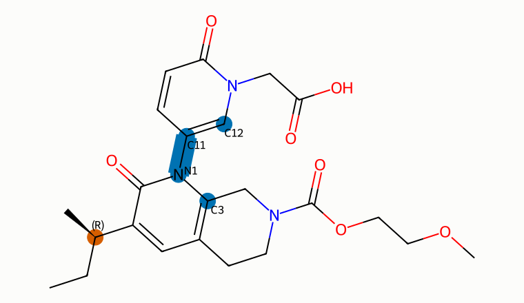

# Cofolding_TestTimeScaling

What co-folding models do at inference time, and what it takes to change their minds.

## The compound



ZWS, as deposited with PDB **8SGE**. Everything here turns on the highlighted
**C11–N1** bond. It joins two substituted rings, rotation about it is hindered, and
the crystal sits at a C12–C11–N1–C3 torsion of **−101.4°**. The two senses of that
torsion are not two points on a freely turning bond — they are separate conformers,
and they put the two halves of the molecule on opposite sides of the pocket.

Boltz-2 picks the wrong one. Across 41 unperturbed runs — model seeds 1–40 and 42 —
**not one pose lands within 2 Å of the crystal**, and only one has the crystal's
axial sense, that one at 8.28 Å: right axis, wrong place.

## Best-of-N

Sampling harder does not help, because there is nothing to sample: the conditioning
is an unperturbed run's only source of randomness, and a given seed returns the same
pose every time.

Replacing the ligand's rows of the trunk single representation with matched Gaussian
noise, once, at the trunk-to-diffusion boundary, **manufactures a distribution where
there was none**.


| model seed | unperturbed | within 2 Å | right axis | runs for a 90% chance |
|---|---|---|---|---|
| 12 | 6.77 Å, wrong | 24 / 40 | 24 / 40 | **3** |
| 42 | 6.76 Å, wrong | 21 / 40 | 21 / 40 | **3** |
| 14 | 6.78 Å, wrong | 1 / 40 | 37 / 40 | 36 |
| 5 | 6.77 Å, wrong | 0 / 40 | 0 / 40 | — |
| 59 | **0.93 Å, right** | 21 / 40 | 21 / 40 | 3 |

Three things in that table are worth more than the headline:

- **Seed 14 is why two metrics are plotted.** The axis flips in 37 of 40 draws and
  the ligand still does not seat, piling up at 2.5–3.5 Å. The axial sense is
  necessary and not sufficient, and a single metric would hide that.
- **Seed 5 does not move at all.** Whatever the intervention erases elsewhere, it
  does not erase here.
- **Seed 59 is a cost, not a rescue.** It is the one conditioning the model already
  placed correctly, and destroying `s_lig` takes it from right-every-time to right
  in 21 of 40. The intervention randomises this conditioning rather than improving it.

The five rows are **not replicates and must not be pooled.** The model seed picks
the conditioning; the direction seed picks a draw from it. Seating rates run 0/40 to
24/40 across conditionings, χ² = 63 on 4 d.f. — and seed 59 was added precisely
*because* the model already succeeds there, so averaging it in would inflate the
result with a conditioning chosen for being easy.

`scripts/figure_8sge.py` draws the per-pose distributions those curves are computed
from.

## Running it

**Inspect** — no GPU, no model, no checkpoint. Reads committed data only.

```bash
pip install -e .
python scripts/figure_compound.py   # -> results/figures/8sge_compound.png
python scripts/figure_bestofn.py    # -> results/figures/8sge_best_of_n.png
python scripts/figure_8sge.py       # -> results/figures/8sge_rescue.png
python scripts/viewer_8sge.py       # -> results/figures/8sge_viewer.html
```

**Reproduce** — needs a GPU, a Boltz-2 install, and the checkpoint and cache, neither
of which is vendored.

```bash
export BOLTZ_CHECKPOINT=/path/to/boltz2_conf.ckpt
export BOLTZ_CACHE=/path/to/boltz/cache

python scripts/run_8sge.py --arm control --draws 30   # ~1 min per draw on one GPU
python scripts/run_8sge.py --arm gauss   --draws 40
python scripts/score_8sge.py --runs runs
```

**The published comparison** — Boltz-Perturb's TCP, ported onto the stock sampler
rather than run from their fork, so its numbers are comparable with the arms above.
`tcp` is their configuration C11 (sigma_max 0.9, psi 0.7, steps 80-159 of 200);
`tcp-c10` widens the window to the whole trajectory; `tcp-frozen` holds the
direction fixed for the run, which is the control that isolates the per-step redraw.

```bash
python scripts/run_8sge.py --arm tcp        --draws 20
python scripts/run_8sge.py --arm tcp-frozen --draws 20
python scripts/run_8sge.py --arm tcp-c10    --draws 20
```

Measured on 8SGE, 20 draws an arm: control 1/20 in the correct basin, our `s_lig`
gauss ablation 9/20, TCP C11 11/20 with 10 poses under 2 A, TCP frozen 7/20 with 3,
TCP C10 5/20 with none. Same magnitude and schedule in the two C11 arms, so the
per-step redraw is the whole of that difference.

Runs are resumable and land under `runs/`, which is not tracked.

## What is in here

```
src/cofolding_tts/
  intervene.py   the hook that replaces the trunk's ligand rows, and the CLI
  tcp.py         Boltz-Perturb's TCP, applied to the conditioner's output
  score.py       symmetry-corrected ligand RMSD after protein alignment
  axis.py        atropisomer-axis perception, and the 8SGE axial label
  lddt.py        lDDT-PLI
  pose.py        Kabsch and mapped RMSD, numpy only
  pdbio.py       column-correct PDB records
data/reference/  the 8SGE inputs a run needs: MSA, sequences, input template
pdb/             deposited structures for the eight systems, with checksums
results/         8sge_per_pose.csv — one row per draw — and figures
docs/method.md   what the intervention is and why it is where it is
```

## Limits

- **One system.** Nothing here shows the intervention generalises.
- **It adds variance, not knowledge.** Nothing selects the right pose. Turning
  21 of 40 into a prediction needs a reference-free ranking signal, which is a
  separate and unsolved problem. The curves above are *oracle* best-of-N.
- **No harm control across systems.** Seed 59 is one within 8SGE and it already
  shows a cost. Whether the same holds generally is unanswered.
- **Ligand RMSD is measured after superposing the protein**, never by fitting the
  ligand to itself, which would hide the placement error being studied.
- **lDDT-PLI is reported but not used as the label.** On this system it separates
  the two basins at 0.84 against 0.61 median, but the ranges overlap
  (0.69–0.90 against 0.00–0.85), so no threshold labels a pose cleanly. The axial
  torsion does, because it *is* the thing that differs.

## Tests

```bash
python -m pytest -q
```

## License

MIT. See `LICENSE`.
